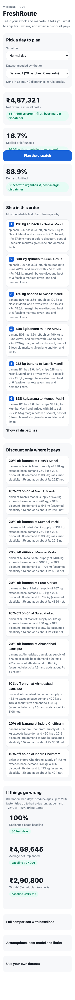

# FreshRoute

**Decision support for perishable produce distribution: what to dispatch first, where to send it, and when a discount pays.** Wild Bugs 24h Online Hackathon, problem statement PS 03.

Live app: https://wild-bugs-ten.vercel.app/ · Demo video (36 s): [docs/demo.mp4](docs/demo.mp4) · Spec: [SPEC.md](SPEC.md)



## The obvious fix vs ours
- Obvious: ship the nearest or highest-priced market first, hope it sells.
- FreshRoute: a max-profit min-cost flow over batch, market and lane. It never creates a shipment that would arrive with less than one day to sell, orders dispatches most perishable first, and keeps a discount only where the simulation shows it adds net money.

## How it works (3 lines)
1. Every batch has remaining shelf life; a shipment is allowed only if shelf life minus travel minus handling leaves at least one sellable day.
2. The planner solves the allocation as min-cost flow (stock, demand, lane capacity), then searches discount levels per market and commodity against a shared cost model.
3. A verifier re-checks stock, lane capacity and shelf-life limits, and a simulator scores the plan against three baselines on the same cost model.

## Requirement table (problem statement to where it lives)
| Mandatory MVP item | Where |
|---|---|
| Batches by commodity, quantity, remaining shelf life | `src/domain/simulator.js`, `src/adapters/generator.js`, UI dispatch list |
| Allocate stock using demand, price, transport time/cost, capacity | `src/application/planner.js` (min-cost flow) |
| Prioritise by perishability and shelf-life feasibility | dispatch rank, `arrivalLife()` rule, verifier |
| Discounts for batches at risk, disclosed assumptions | planner discount search, elasticity 1.5 shown in the UI assumptions panel |
| Compare against baseline: spoilage, fulfilment, net revenue after defined costs | first screen cards and the comparison table |
| Optional: replan on disruption, uncertainty | situation presets (closed market, delay, heat wave, demand drop), 30-draw stress test |

## Results on 30 hidden datasets (seeds 1000-1029, never used while developing)
Run `npm run eval`. Full output: [eval-results.json](eval-results.json).
| Metric | FreshRoute | Strongest baseline (urgent-first, best-margin dispatcher) |
|---|---|---|
| Spoiled + unsold + written-off share of stock | 18.0% | 29.0% |
| Net revenue (mean, INR) | 500,820 | 474,076 (+5.6%) |
| Beats all three baselines on net | 30 of 30 datasets | |
| Fulfilment (mean) | 82.2% | 81.5% (plan wins 73% of datasets, profit-first objective) |
| Hard-rule violations | 0 of 30 | |
| Replanned dispatch vs baseline in 300 stress draws | 300 of 300 | |
| Planning time | under 100 ms (max 89 ms) | |

Honest notes: the two naive baselines (FIFO nearest, FIFO highest price) lose by a wide margin, so the table uses the strongest one. Data is synthetic and shows behaviour, not real-world performance. Government post-harvest loss statistics are context only.

## Run and test
```
npm test         # 14 tests (domain, planner, baselines, sensitivity, validation)
npm run eval     # hidden-seed evaluation
python3 -m http.server 8080 --bind 127.0.0.1   # then open http://127.0.0.1:8080
python3 scripts/smoke.py                       # browser smoke at 390 and 1280 px (needs playwright)
```
No build step, no dependencies, no external fonts or CDN. Architecture: `domain` (pure) <- `application` <- `adapters` <- `ui`.

## Pre-existing code (Devfolio Code of Conduct disclosure)
Application code in `src/` was written during the hackathon window. Reused from the author's earlier hackathon projects: the demo-video builder pattern in `video/build.py` (narration, Playwright recording, ffmpeg mux, caption burn-in) and the browser smoke script pattern in `scripts/smoke.py`. They are tooling for the demo video and checks, not part of the product. Text to speech uses edge-tts.
